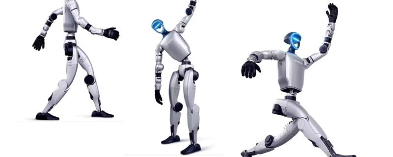

<!-- esasim: cover -->

<!-- /esasim: cover -->

<!-- Banner: upload a picture named banner.png under Data › Readme pictures (the robot climbing the circuit's stairs, from the Side camera, works well), then:  -->

# Humanoid training

**A humanoid robot (Unitree G1 by default, or a Unitree H1 or an Apptronik Apollo) learns to get up and to walk by reinforcement learning, then walks a circuit live in 3D: rough ground, slopes, moving tiles, a staircase of 10 steps up and 10 down, and ice; and you drive it by hand round a playground of sand, water and obstacles.**

Thousands of robots learn at once on your GPU, in MuJoCo physics: to get up after a fall, to walk straight on a flat floor at the speed asked, then to go round a rectangular circuit, following its line, reading the ground ahead from the depth camera in its head. Then one robot walks the circuit live, lap after lap, steered and pushed by hand from the view, seen from its own head camera and with every sensor and joint on a telemetry window.

   -orange)  

## Overview

Walking is hard for a humanoid: it is never statically stable. The G1 stands on two feet 18 cm long and must keep catching itself, 50 times a second, with 29 motors that only follow position targets through their own stiff loops.

Nobody writes the walking here. A neural network (the **policy**) reads what a real robot can sense (its speed and turn rates from the IMU, which way is down, the angle and speed of every joint, what it did last, the speed it is asked for and the beat of its steps) and sets the targets for its joints. It learns by trial and error (PPO, proximal policy optimisation) over hundreds of millions of steps, with thousands of robots at once on the GPU.

The policy also **sees the ground ahead**: an elevation map of 13 × 5 points, from 0.3 m behind its feet to 1.5 m ahead and 0.3 m either side, as the depth camera in its head gives it (with a couple of centimetres of noise and offset, as a real one would). On a flat floor the map is flat and changes nothing; on stairs it is what lets it place its feet on the treads instead of finding the risers with its toes. It cannot see how slippery the ground is: the ice it learns by feel.

## Flows

Run them in this order:

- **1 · Learn to stand up**: robots lying where a fall left them learn to get up and stay up, with an upward help on the torso that is taken away as they succeed. The stand-up policy goes to the **humanoid-policy** dataset, and the circuit test uses it to get up on its own after a fall.
- **2 · Learn to walk**: thousands of robots at once on the GPU learn to walk straight on a flat floor, at speeds from standing to 1 m/s, pushed now and then and started in odd poses. One robot's episode is replayed in 3D every 20 seconds, with charts of the walk score, the falls, the episode length and the speed error. The policy goes to the same dataset.
- **3 · Learn the circuit**: carries on from the best policy so far, now on the circuit: robots start anywhere on its line (more of them near the stairs, the moving tiles and the ice), either way round, and a third of them in the practice yard. The policy goes to the same dataset (`humanoid_walk_circuit_…pt`).
- **4 · Test the circuit**: the newest policies walk the robot live, in real time, round the circuit, lap after lap: the rough ground and the ramp on side 1, the moving tiles on side 2, the staircase on side 3, the ice on side 4. From the main view's bar: **Push** (a hand: click it, then click the robot where you want to push it; it is pushed the way you are looking, as hard as **Push strength**; click Push again or press Esc to stop), **Reset** (back to the start line), **speed** and **heading** (beyond ±90° it turns round and walks the circuit clockwise). Next to it: the robot's own head camera (colour and depth), cameras behind and in front of it, and the **telemetry** window. Captions say what it walks on, when it falls and each lap's time.
- **5 · Playground**: you drive the robot by hand, with its newest policies, over an open floor of obstacles (below). From the main view's bar: the **drive pad** (hold a button: forward, back, turn left or right, step aside; ■ stops) or the keyboard (click the view first: **W A S D** or the arrows, **Q E** to step aside, **Space** to stop), **Push**, **Push strength**, **Reset** and **speed**. Next to it: its head camera, a camera behind it and the telemetry window.

Standing up first is a choice more than a need: **3** carries on from **2**'s policy, and **4** and **5** walk with what the others made.

## The robot

| Part | What is simulated |
|---|---|
| **Body** | Unitree G1, 29 joints, 30 links with their masses and inertias (about 35 kg, 1.3 m), from MuJoCo Menagerie |
| **Motors** | position loops on every joint (stiffness 75, ankles 20, ankle roll and wrists 2), each with its torque limit (up to 139 N·m at the knees) and rotor inertia |
| **Feet** | boxes 18 × 6 cm with friction on the floor (0.6), on the circuit and on the moving tiles (0.8), on the ice (0.08); the legs, hands, pelvis, torso and head touch the ground too when it falls |
| **Sensors** | the pelvis IMU (gyro, accelerometer, gravity), joint angles and speeds, foot contacts and loads; what the policy reads carries sensor noise while it learns |
| **Head camera** | a RealSense D435i in the head, looking down 48° (69° × 42° in colour, 0.2–5 m of depth shown); the policy reads the ground from it as the elevation map, shown as dots under **Sensors** in the 3D view |
| **Timing** | physics at 500 Hz, the policy at 50 Hz |

### Choosing the robot

The G1 is the default. Every **Humanoid** block has a **Robot** setting (select the block in the blueprint of each flow) with three choices:

| Robot | Size | Joints |
|---|---|---|
| **Unitree G1** (default) | 1.3 m, 35 kg | 29 |
| **Unitree H1** | 1.8 m, 51 kg | 19 |
| **Apptronik Apollo** | 1.7 m, 81 kg | 32 |

Each robot keeps its own policies, and the file names say whose they are: `humanoid_walk_…` and `humanoid_standup_…` are the G1's, `humanoid_h1_walk_…` and `humanoid_apollo_standup_…` the others'. They all go to the same **humanoid-policy** dataset; a run uses only the policies of the robot it is set to and leaves the others as they are, so you can switch back and forth and lose nothing. Set the same robot in the flows that learn and in the flows that walk it. The 3D view draws whichever robot the run sends.

The rewards and settings were tuned on the G1. The H1 and the Apollo learn the same task scaled to their height and weight: expect them to need longer, and perhaps some tuning, to walk as well.

## The circuit

A 38 × 18 m rectangle with rounded corners (2.5 m), 108 m round, walked counterclockwise from the start line (or clockwise). A grey lane marks its line; the robot follows it with a guide, as a driver with a joystick would.

| Where | What | |
|---|---|---|
| **Side 1** | flat start, then a 4 × 4 m square of **bumps** (0–4 cm), a **slope up** of 12.5 % (7°) to a **plateau** 0.5 m up, a **slope down**, a 4 × 4 m square of **blocks** (0.4 m tiles, 0–5 cm) | rubber granulate, grooved concrete, edges a foot can catch |
| **Side 2** | **moving tiles**: a 4 × 4 m square of 64 tiles, 0.5 m each, every one rising and falling on its own rhythm (2–8 cm, every 1.5–4 s) | in training a new pattern every episode; in Walk always the same one |
| **Side 3** | a **staircase** 3 m wide: **10 steps up** (12 cm risers, 30 cm treads), a 2 m landing 1.2 m up, **10 steps down** | yellow nosings and handrails |
| **Side 4** | a 4 × 4 m square of **smooth ice** (friction 0.08 against 0.6–0.8 elsewhere, its top 6 mm up), then flat, back to the start line | the feet slide: a test of balance |
| **Inside** | the **practice yard**: four staircases of 10 steps up and 10 down, with 6, 9, 12 and 15 cm risers, 1.8 m wide | labelled "PRACTICE n cm"; used only in training |

The physics uses the ground as one heightfield (a point every 5 cm), the ice as a heightfield of its own that only the feet touch, and the moving tiles as 64 boxes moved each step; the 3D view builds the same ground from the same numbers and moves the tiles on the same clock, so what you see is what the feet touch.

## The playground

An open floor of obstacles for driving by hand (Walk with Ground **Playground**). The robot starts at one end, facing them; straight ahead is a clear way to the steps.

| What | Where | How it behaves |
|---|---|---|
| **Gravel** | 4 × 4 m, near, on the right | grains of 0–2 cm |
| **Stepping stones** | 4 × 4 m, near, on the left | 0.4 m slabs, about half of them raised 3–8 cm |
| **Sandbox** | 5 × 5 m, middle, on the right, in a timber frame | 3 cm of soft sand: the feet sink 1.5–2 cm and leave prints |
| **Water** | 5 × 5 m pool, middle, on the left | 10 cm deep: it drags at the feet (about 60 N on a foot moving at 2 m/s) |
| **Ice** | 4 × 4 m, far, on the right | friction 0.08: the feet slide |
| **Curbs** | far, on the left | two, 6 and 10 cm high, across the way |
| **Steps** | at the far end, straight ahead | 4 up of 10 cm, a landing, 4 down, with handrails |

The policies learn on the circuit, which has the same kinds of ground except the sand and the water: those two are new to them, a test of how well they cope with what they never saw.

## The learning

- **Rewards** (after MuJoCo Playground's G1 joystick task): walking at the speed and turn asked, lifting the feet in step with a gait clock, staying up; penalties for tilting, slipping, jerky actions, joints near their limits and straying from the standing pose. A step never pays less than nothing, so staying up always beats falling.
- **Commands**: mostly along its line (the circuit's, or a yard staircase's), sometimes random turns and side steps, sometimes standing still: what lets it be driven by hand.
- **Robustness**: pushes of up to 1.5 m/s every 5–10 s, starting poses with every joint off by up to 50 %, noise on what it senses and on the elevation map.
- **Carrying on**: flow 3 starts from the best flat-floor policy. A policy that learned blind gets the elevation map as new inputs that start at zero, so it walks exactly as before; the critic first learns what the new ground is worth (25 iterations), then the policy adapts.
- **Score**: the walk score is how well it keeps the speed asked times the share of episodes it does not fall (100 % = always on its feet, always at the speed asked).

## Where it runs

- **NVIDIA GPU**: the way to train. MuJoCo Warp runs the whole simulation on the card, moving tiles and ice included. On an RTX 3070 with 4,096 G1s, flow 2 ran at 25,000–50,000 steps a second, and the walk score levelled off at 84–85 % after about an hour (165 million steps). Flow 3 has much more to learn (stairs and ice above all): give it 2 hours or more and watch the falls chart.
- **CPU**: works, with at most 512 robots at once; about 1,000–3,000 steps a second, fine to try it, far too slow to learn a walk.
- Flows 4 and 5 run on any machine: one robot, in real time, on the CPU.

## What you need

- A machine with the EsaSim worker (Project › Compute), with an NVIDIA GPU for training.
- Python packages, installed by the worker the first time: `torch` (with CUDA on NVIDIA machines), `mujoco`, `mujoco-warp`, `warp-lang`. Nothing else is downloaded and no account or key is needed.
- Somewhere for the policies: the **humanoid-policy** dataset, made by the first training run.

## How to run it

**If you took this project from Demos**, first tell it where your policies live (a copy keeps no link to anyone else's storage):

1. Open **1 · Learn to stand up** under **Blueprint**, select the training block and set **Outputs go to** to a place in your workspace, with the dataset name `humanoid-policy`. Do the same in **2 · Learn to walk** and **3 · Learn the circuit**.
2. Once the dataset exists, set the **Policies** block of flows 1, 3, 4 and 5 to it.

Then:

1. Under **Compute**, check that a machine with an NVIDIA GPU is available for this project.
2. Run **1 · Learn to stand up** (180 minutes; it can also come later), then **2 · Learn to walk** (90 minutes by default). **Finish now** ends either early and still keeps the best policy.
3. Run **3 · Learn the circuit** (240 minutes) to teach it the circuit: the stairs, the moving tiles, the ice, the slopes and the rough ground.
4. Run **4 · Test the circuit** and watch it go round, lap after lap; push it by hand to test its balance. It always walks with the newest policy, so you can also run it before 3: the flat-floor policy manages the corners, the slopes and the tiles, but falls on the stairs, having never seen one.
5. Run **5 · Playground** and drive it: click the main view, then use the drive pad or the keyboard.

To train another robot, set **Robot** on the Humanoid block of each flow you run (the same one everywhere), then follow the same steps.

## Settings worth knowing

- **All flows**: **Robot** (Unitree G1, Unitree H1 or Apptronik Apollo).
- **Learn to stand up / Learn to walk / Learn the circuit**: **Ground** (Flat floor or Circuit), **Robots learning at once** (4,096 on a GPU), **Minutes**, **Top speed asked** (1 m/s), **Pushes up to** (1.5 m/s), **Replay every** (20 s), **Training** (Continue: it carries on from this robot's policy with the most experience; Start over: from nothing).
- **Walk** (Test the circuit): **Ground**, **Walking speed** (0.6 m/s to start), **Heading** (beyond ±90°: clockwise), **Policy file** (empty: the newest), **After a fall**, **Minutes** (30). In the view's bar, **Push strength** (0.8 m/s): how hard a push by hand is, as a shove of that speed to the whole robot.
- **Playground** (5 · Playground): **Walking speed** sets how fast forward is (back is half of it, sideways 0.35 m/s, turning 0.9 rad/s). If the view stops sending (the page closed), the robot stops after a second.
- In the 3D view: the bar switches cameras (Director, Follow, Side, Front, Orbit, Free, Robot's eyes, Depth camera), and turns Sound and Sensors on or off. Sound is the footsteps (a fall: a louder one; a splash in the water) and a faint motor hum; switched off, it is silent. Sensors shows the speed asked and measured, the turn, how far off the line it is (in the playground: how it is driven), what it walks on, its height above the ground, the load on each foot and the elevation map's dots.
- Fixed views for a wall of windows: `humanoid: follow`, `side`, `front`, `eyes`, `depth` and `telemetry` (Camera in the view's settings). They are silent.

## What you get

- `humanoid_walk_<date>_<NN>.pt`, `humanoid_walk_circuit_<date>_<NN>.pt` and `humanoid_standup_<date>_<NN>.pt` in the **humanoid-policy** dataset (with `h1_` or `apollo_` after `humanoid_` for the other robots): the policy (network, input scaling, the robot, the ground it learned on, its score NN %, its steps of experience).
- **training.csv** and **standup.csv**: the learning curves.
- Live in the views: the replayed episodes while learning (the stairs, the yard, the tiles, the ice); the walk round the circuit or the playground with the head camera, the depth camera and the telemetry window (speed and turn asked and measured, height above the ground, attitude, gyro, accelerometer, foot loads and contacts, leg angles and torques, and a board of all its joints); captions as it reaches each part, is pushed, falls, or finishes a lap.

## Data and licences

- No dataset is read: every step is simulated.
- G1 physics model: MuJoCo Menagerie (Unitree G1, BSD-3-Clause), with the collision set and task design of MuJoCo Playground (Apache 2.0), both by Google DeepMind. MuJoCo and MuJoCo Warp by Google DeepMind (Apache 2.0).
- Unitree H1 (Unitree Robotics, BSD-3-Clause) and Apptronik Apollo (Apptronik, Apache 2.0): MuJoCo Menagerie models, their 3D look simplified from the same meshes.
- 3D model: "Unitree G1 Humanoid (rigged)" by **KenzoDkohno22T**, [CC BY 4.0](https://creativecommons.org/licenses/by/4.0/) (Sketchfab); simplified to 214,000 triangles, compressed, animation removed.
- The code of the blocks is EsaSim's.

## Notes

- A policy that learned only on the flat floor already goes round the corners and over the moving tiles at 0.6 m/s, but it trips on the stairs and slides on the ice. **3 · Learn the circuit** is there to close that gap; the practice yard lets it learn low steps before the 12 cm ones.
- The elevation map is read from the simulation's ground under the points the camera sees, with noise; a real robot would build it from the depth images.
- Falls in **Walk** are decided by the physics: with a stand-up policy it gets up on its own; without one it is back on its feet 3 s later (on the circuit's line a step further on; in the playground where it fell).
- The view shows the robot about a second behind the simulation (frames arrive in bursts), so a push or a turn lands a moment after the click.
- The circuit, the stairs, the moving tiles and the elevation map need the 3D view 1.51 or later; the H1 and the Apollo 1.56; the ice and Push by hand 1.57; the playground and the drive pad 1.58.

<!-- esasim: files of the project -->

---

An [EsaSim](https://esacode.com/) project of the workspace Gianluca De Novi's workspace (Robotics & manipulation).

### Blueprints in this repository

- [1 · Learn to stand up](blueprints/1-learn-to-stand-up.json) · 10 blocks · version 1
- [2 · Learn to walk](blueprints/2-learn-to-walk.json) · 9 blocks · version 7
- [3 · Learn the circuit](blueprints/3-learn-the-circuit.json) · 11 blocks · version 5
- [4 · Test the circuit](blueprints/4-test-the-circuit.json) · 9 blocks · version 8
- [5 · Playground](blueprints/5-playground.json) · 7 blocks · version 2

### Workspace blocks it uses

- [Humanoid](blocks/ws-humanoid-g1) · version 11

### Assets

The files the project's views draw with (3D models, textures, sounds), in [assets/](assets/):

- [humanoid-policy/humanoid_h1_walk_20261113_1351_90.pt](assets/humanoid-policy/humanoid_h1_walk_20261113_1351_90.pt) · 5.5 MB
- [humanoid-policy/humanoid_standup_20261112_1839_55.pt](assets/humanoid-policy/humanoid_standup_20261112_1839_55.pt) · 5.9 MB
- [humanoid-policy/humanoid_walk_20261112_0039_85.pt](assets/humanoid-policy/humanoid_walk_20261112_0039_85.pt) · 1.7 MB
- [models/g1.glb](assets/models/g1.glb) · 5.8 MB
- [models/robot-apollo.json](assets/models/robot-apollo.json) · 2.1 MB
- [models/robot-h1.json](assets/models/robot-h1.json) · 1.1 MB
- [textures/esacode-logo.png](assets/textures/esacode-logo.png) · 25 KB

Keys pasted in blocks (secret settings) are not saved here, nor are the team and the results of runs.
